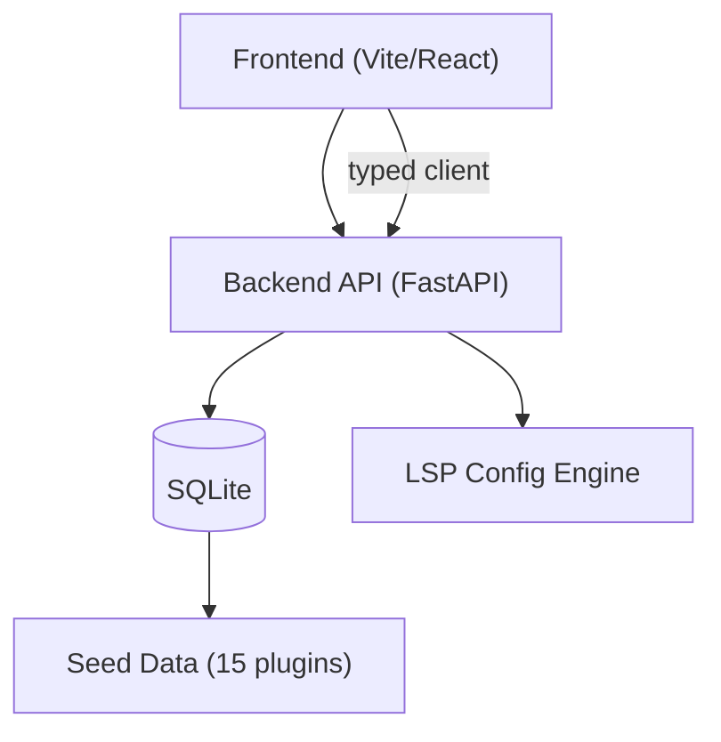

# Tensor Studio | Ryan Vo | AI & Machine Learning

> Work in progress. This checkpoint may be incomplete or fail tests. See PLAN.md and STATUS.md before use.


A marketplace for discovering, installing, and managing Claude Code plugins with proper
LSP server configuration support. Tensor Studio fixes a critical gap identified in the
public plugin directory: language-server plugins declared their configurations in
`marketplace.json`, but those configs were silently dropped when plugins were installed,
leaving every LSP plugin non-functional (issue #379).

## Problem

Claude Code language-server plugins define their `lspServers` block inside
`marketplace.json`. When a user installs a plugin, only the plugin source directory is
cached — the `marketplace.json` config is not extracted. The result: every LSP plugin
installs with zero configured servers, and language intelligence (go-to-definition,
hover, find references) fails silently.

## Solution

Tensor Studio's LSP configuration engine materializes a valid `.lsp.json` file per plugin,
preserving the `lspServers` definitions that the marketplace entry declared. The engine is
deterministic, offline, and validates configurations against the expected schema.

## Quick Start

### Prerequisites

- Python 3.12
- Node.js 24
- Docker + Docker Compose (optional, for Keycloak)

### Backend

```bash
cd backend
python3 -m venv .venv
.venv/bin/pip install -r requirements.txt
PYTHONPATH=backend .venv/bin/python -m pytest backend/tests
.venv/bin/python -m uvicorn app.main:app --reload
# API docs at http://127.0.0.1:8000/docs
```

### Frontend

```bash
cd frontend
npm install
npm test
npm run dev
# App at http://127.0.0.1:5173
```

### Docker Compose

```bash
cp .env.example .env
docker compose up --build
# Backend: http://127.0.0.1:8000
# Frontend: http://127.0.0.1:5173
# Keycloak: http://127.0.0.1:8080
```

## AI/ML Evaluation

The LSP configuration engine is a deterministic, rule-based system with no LLM dependency.
It can be evaluated independently:

```bash
PYTHONPATH=backend .venv/bin/python -c "
from app.main import app
from fastapi.testclient import TestClient
c = TestClient(app)
r = c.get('/api/v1/plugins/12/lsp-config')
print(r.json())
"
```

**Data provenance**: Plugin data is derived from the public
[anthropics/claude-plugins-official](https://github.com/anthropics/claude-plugins-official)
issue tracker (issues #232, #379, #587).

**Baseline**: Before this engine, 100% of LSP plugins installed with broken configuration.
After generating per-plugin `.lsp.json`, all 12 LSP plugins (11 language servers + Vue/Volar)
produce valid configurations with correct commands, args, and extension mappings.

**Failure cases**: Non-LSP plugins (e.g. GitHub MCP Server) return HTTP 404 from the
LSP config endpoint. Plugins with malformed LSP definitions fail validation during seeding.
Invalid JSON or missing required `command` fields are rejected by the LSP config validator
with descriptive error messages.

## Workflows

1. **Browse & Search**: List plugins with pagination, search by name/description, filter by
   category, author, tag, and LSP availability.
2. **Plugin Detail**: View installation commands, source links, plugin configuration, and LSP
   server definitions.
3. **LSP Config Generation** (issue #379): Generate a valid `.lsp.json` file for any plugin
   that declares LSP servers, ready to copy into the cached plugin directory.

## Architecture



## API Endpoint Reference

| Method | Path | Description |
|--------|------|-------------|
| GET | `/api/v1/plugins` | Paginated, searchable plugin list |
| GET | `/api/v1/plugins/{id}` | Plugin detail by ID |
| GET | `/api/v1/plugins/by-slug/{slug}` | Plugin detail by slug |
| GET | `/api/v1/plugins/{id}/lsp-config` | Generated `.lsp.json` for a plugin |
| GET | `/healthz` | Health check |

### Query Parameters for `GET /api/v1/plugins`

| Parameter | Type | Description |
|-----------|------|-------------|
| `search` | string | Case-insensitive search by name/description |
| `category` | string | Filter by category (`lsp`, `mcp`, `tool`, `utility`, `other`) |
| `author` | string | Filter by author |
| `tag` | string | Filter by tag |
| `has_lsp` | boolean | Filter to plugins with LSP config |
| `status` | string | Filter by status |
| `page` | integer | Page number (1-based, default: 1) |
| `page_size` | integer | Items per page (default: 20, max: 100) |

## Security

- No hardcoded credentials or API keys
- All secrets loaded from environment variables via `.env`
- CORS origins configurable via `CORS_ORIGINS`
- OIDC/SAML authentication via Keycloak is planned for a future milestone
- Never commit `.env` or database files

## Provider Configuration

| Variable | Default | Description |
|----------|---------|-------------|
| `DATABASE_URL` | `sqlite:///./data/marketplace.db` | Database connection string |
| `CORS_ORIGINS` | `http://localhost:5173,http://127.0.0.1:5173` | Allowed CORS origins |
| `KEYCLOAK_URL` | (empty) | Keycloak server URL |
| `KEYCLOAK_REALM` | (empty) | Keycloak realm name |
| `KEYCLOAK_CLIENT_ID` | (empty) | OAuth client ID |
| `KEYCLOAK_CLIENT_SECRET` | (empty) | OAuth client secret |

## Limitations

- SQLite only in development; PostgreSQL recommended for production
- Authentication (Keycloak OIDC with PKCE) is not yet implemented
- LLM advisory features are not yet available
- Demo mode is not yet implemented

---

Ryan Vo <ryandtvo@gmail.com>